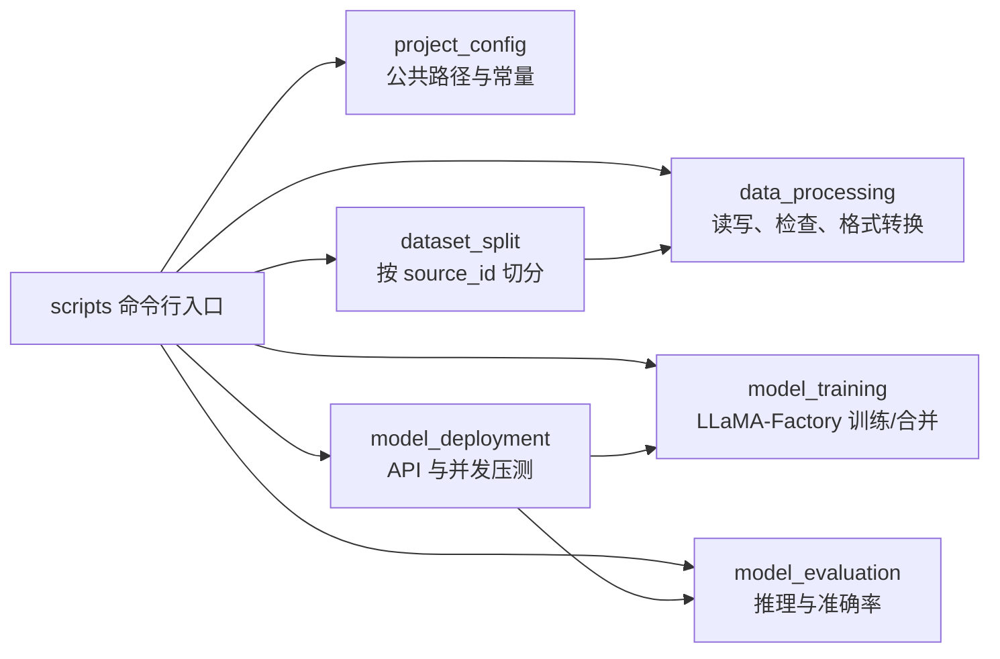

# Qwen3-4B SFT 快速验证完整流程

本手册中的微调模型是 **Qwen3-4B**，训练框架是 **LLaMA-Factory 0.9.4**。
4B 的定位是用较低成本验证租赁 GPU 环境、训练链路、语料适配性和基础指标是否提升，
不是最终业务模型。业务正式模型 Qwen3-8B 的独立训练与验收见
[`QWEN3_8B_FINE_TUNING.md`](QWEN3_8B_FINE_TUNING.md)，总放行逻辑见
[`FINETUNING_RUNBOOK.md`](FINETUNING_RUNBOOK.md)。

开始 SFT 前应先在同一冻结测试集评测 4B 基座。只有保存了基座指标，才能判断 SFT 是否提升。

```bash
uv run python code/scripts/05_evaluate_model.py \
  --model-path model_files/Qwen3-4B \
  --dataset code/data/datasets/llamafactory/recruitment_sft_frozen_test_quick_30pct.jsonl \
  --output-dir code/outputs/evaluation/qwen3-4b-base-quick30 \
  --batch-size 1 \
  --max-new-tokens 512 \
  --torch-dtype bf16
```

## 1. 数据检查

`01_check_data.py` 从 `tasks_fixed/<task>/train.jsonl` 读取九个任务，检查
`sample_id`、`task`、`messages` 和 assistant JSON 答案。

```bash
uv run python code/scripts/01_check_data.py --limit-per-task 100
uv run python code/scripts/01_check_data.py
```

## 2. 数据集切分

切分单位是 `source_id`，不是单条样本。这样同一职位派生的抽取、分类等多个任务不会跨集合。

```bash
uv run python code/scripts/02_split_dataset.py \
  --output-dir code/data/datasets/candidates/gemini-v2-split-demo
```

如果 `tasks_fixed` 未变，正式训练直接复用已有 `gemini-v2-split-v2`。

## 3. LLaMA-Factory 格式

九个任务的同名 split 会合并为一个 ShareGPT JSONL 文件。

```bash
uv run python code/scripts/03_prepare_training_data.py \
  --output-dir code/outputs/demo_llamafactory_data
```

## 4. LoRA SFT

训练使用 LLaMA-Factory 原生命令，训练参数集中在 YAML 中。

在新租赁环境上先复制配置，设置独立 `output_dir`、`max_steps: 20`、
`do_eval: false`、`eval_strategy: "no"` 和 `load_best_model_at_end: false` 做冒烟训练。
确认无 CUDA OOM、loss 为有限值且 Adapter 能保存后，
再执行下列完整训练；不要用冒烟输出替代正式结果。

```bash
uv run llamafactory-cli train code/configs/qwen3_4b_sft.yaml
```

## 5. 模型评估

评估模块使用与训练相同的 messages，统计 JSON 成功率、schema 精确率、字段精确率和对象全匹配率。

```bash
# 只验证评估代码
uv run python code/scripts/05_evaluate_model.py --gold-as-prediction --limit 20

# 真实评估 LoRA adapter
uv run python code/scripts/05_evaluate_model.py --limit 100
```

最终结论必须来自完整冻结测试集，并与第 0 步的 4B 基座在相同推理参数下比较。
重点观察 `json_parse_rate`、`schema_exact_rate`、`field_exact_rate` 和
`object_exact_rate`。只有 4B 链路与指标门禁通过后，才建议租用更长时长执行 8B。

评测输出中的 `classification_metrics.md` 展示全部八个分类任务的准确率和 macro F1；
详细逐类别指标与稀疏混淆矩阵位于 `metrics.json` 的 `classification.by_task`。

## 6. 合并与部署

```bash
uv run llamafactory-cli export code/configs/qwen3_4b_export.yaml
uv run python code/scripts/07_serve_model.py --host 0.0.0.0 --port 8000
```

API 由 LLaMA-Factory 提供，路径为 `/v1/chat/completions`。生产环境应通过 `API_KEY` 环境变量开启认证。

## 7. 服务压测

```bash
uv run python code/scripts/08_benchmark_service.py \
  --requests 100 \
  --concurrency 8
```

报告包含成功率、RPS、输出 token/s、mean/p50/p95/p99/max 延迟和错误分类。

## 8. 模块调用关系


